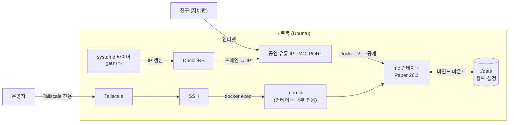

# minecraft-devops

노트북 1대에서 Docker로 Paper 마인크래프트 서버를 운영하고, 백업·DDNS·관리 API·모니터링까지 자동화해 가는 홈랩 프로젝트입니다.

## 소개

- **운영**: 친구들과 함께 쓰는 자바판 서버를 노트북 1대와 Docker Compose로 운영합니다.
- **자동화**: 백업, 유동 IP 대응(DDNS), 관리 API, 모니터링을 단계적으로 붙입니다.
- **학습**: Docker와 DevOps를 직접 운영하며 배우고, 결정과 과정을 이슈·기획 파일로 남깁니다.

## 구성도



## 기술 스택

| 분류 | 사용 | 상태 |
| --- | --- | --- |
| OS | Ubuntu Desktop (노트북 1대) | 사용 중 |
| 컨테이너 | Docker, Docker Compose | 사용 중 |
| 서버 | [itzg/minecraft-server](https://github.com/itzg/docker-minecraft-server), Paper 26.3 | 사용 중 |
| 원격 접속 | Tailscale, SSH(키 인증) | 사용 중 |
| 방화벽 | ufw | 사용 중 |
| 작업 관리 | GitHub Issues·PR, gh CLI, Claude Code | 사용 중 |
| 자동화 스크립트 | Bash, shellcheck, systemd 타이머 | 사용 중 |
| DDNS | DuckDNS, systemd 타이머 | 사용 중 |
| 관리 API | FastAPI | 예정 |

## 보안 설계

- **외부 공개 포트는 하나**: 인터넷에 열리는 건 마크 서버 포트뿐입니다. 다른 서비스는 `127.0.0.1`이나 Tailscale 주소에만 바인딩합니다.
- **RCON 미공개**: RCON(25575)은 `ports`에 넣지 않고, 컨테이너 안에서 `rcon-cli`로만 씁니다.
- **Docker의 ufw 우회 대응**: Docker가 공개한 포트는 ufw 규칙을 거치지 않습니다. 그래서 방화벽이 아니라 compose의 바인딩 주소로 노출 범위를 통제합니다.
- **비밀값 분리**: 포트, 버전, 토큰은 `.env`에 두고 커밋하지 않습니다. 저장소에는 키 목록인 `.env.example`만 있습니다.
- **공개 저장소 원칙**: 호스트 IP, 네트워크 인터페이스, 실제 포트, 플레이어 닉네임은 저장소 밖에 둡니다. 원격 관리는 Tailscale로만 합니다.

자세한 규칙과 확인 방법: [docs/design/verification.md](docs/design/verification.md)

## 실행 방법

필요한 것: Docker, Docker Compose

```bash
cp .env.example .env
# .env에서 MC_PORT(외부 공개 포트)와 MC_VERSION(예: 26.3)을 채운다

docker compose config -q      # 설정 검사
docker compose up -d          # 기동
docker logs mc --tail 50      # "Done" 확인

docker exec mc rcon-cli whitelist add 닉네임   # 화이트리스트 추가
```

- 월드 데이터는 `./data`에 남습니다. 정지는 `docker compose down`으로 하고, `-v`는 쓰지 않습니다.
- 서버 설정은 `data/` 안 파일을 직접 고치지 않고 `compose.yaml` 환경변수로 바꿉니다.
- 친구용 접속 안내: [docs/player-guide.md](docs/player-guide.md)

## 작업 흐름

Claude Code 스킬로 이슈부터 PR까지 같은 순서로 진행하고, 매 단계를 기록으로 남깁니다.

```
/issue → /plan → /task → /pr → (다른 사람 PR은) /review → merge
```

| 단계 | 남는 것 |
| --- | --- |
| `/issue` | GitHub 이슈, 작업 브랜치, 빈 기획 파일 |
| `/plan` | 기획 파일(목적·수용 기준·영향 범위), 결정 기록 |
| `/task` | 구현, 검증 결과, 문서 갱신 |
| `/pr` | 커밋, "확인한 것 / 확인하지 못한 것"을 나눈 PR |

- 브랜치: `main`(안정) ← `develop`(통합) ← `feature/`·`fix/`·`docs/`·`chore/` 작업 브랜치
- 검증: `docker compose config -q`, `shellcheck`, 포트·비밀값 점검을 통과해야 푸시합니다.
- 협업 규칙 전체: [docs/development/collaboration.md](docs/development/collaboration.md)

## 로드맵

| 순서 | 작업 | 상태 |
| --- | --- | --- |
| 1 | Docker 설치 확인 | 완료 |
| 2 | `compose.yaml` 작성·배포, 친구 접속 테스트 | 완료 ([#1](../../issues/1)) |
| 3 | DuckDNS DDNS (유동 IP 대응) | 완료 ([#10](../../issues/10)) |
| 4 | 월드 백업 자동화 | 예정 |
| 5 | FastAPI 관리 API | 예정 |
| 6 | 모니터링, 모니터링 GUI | 예정 |
| 7 | GitHub Actions (compose config, shellcheck) | 예정 |

## 문서

| 문서 | 내용 |
| --- | --- |
| [docs/design/00-overview.md](docs/design/00-overview.md) | 목적, 구성, 디렉토리, 로드맵 |
| [docs/design/systems/](docs/design/systems/) | 영역별 기준 문서 (서버, 네트워크, 백업, API, 모니터링) |
| [docs/design/decisions.md](docs/design/decisions.md) | 결정 기록 (날짜, 결정, 이유) |
| [docs/design/verification.md](docs/design/verification.md) | 항상 지켜야 할 규칙과 확인 방법 |
| [docs/plan/](docs/plan/) | 이슈별 기획 파일 |
| [docs/development/contributor-guide.md](docs/development/contributor-guide.md) | 작업 흐름 사용법 |
| [docs/player-guide.md](docs/player-guide.md) | 친구용 접속 안내 |

## 디렉토리

```
.
├── compose.yaml        서버 정의
├── .env.example        .env 키 목록 (.env는 커밋하지 않음)
├── scripts/            운영 스크립트 (DuckDNS 갱신, systemd unit 생성)
├── deploy/systemd/     systemd unit 템플릿
├── docs/               기준 문서, 기획 파일, 협업 문서, 접속 안내
├── .claude/skills/     작업 흐름 스킬 (issue, plan, task, pr, review)
├── .github/            이슈 템플릿
└── data/               월드 데이터 (git 제외)
```

## 라이선스

[MIT](LICENSE)

쓸 만했다면, 언젠가 만났을 때 맥주 한 잔 사 주세요.
